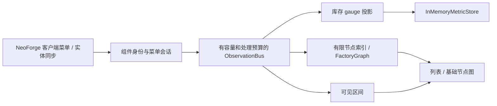

# 架构与数据语义

## 方向与当前范围

目标是观察工厂运行，而非仅计算配方。LItemFinder 提供资源位置、数量和 availability，本项目负责流动、堆积、产线状态、预测与诊断。

Core 可以在普通 JVM 中验证；首个实际平台已接通以下路径：



真实游戏对象只由 NeoForge 平台在客户端游戏线程读取。common 中的菜单会话、索引和分析会话只接收 DTO。当前没有生产速率推断或持久化历史，也不读取服务器容器或 capabilities。

## 模块依赖

当前生产代码依赖：

```text
core                  -> JDK
compat-api            -> core
minecraft-common      -> core
test-fixtures         -> minecraft-common -> core
platform-neoforge     -> minecraft-common / compat-api / core + NeoForge / Minecraft
```

NeoForge 层负责事件、配置、路径、按键和界面。Fabric 和具体 Mod 适配器仍为预留模块，它们不得反向成为 Core 的依赖。Core 和 common 生产代码均不引用 Minecraft 类型。

Core 的 `check` 会验证生产源码的 import 边界和空的外部运行时依赖。未来引入数学或序列化库时，需明确调整这一规则并记录理由。

## 资源与主体身份

`ResourceId` 由 namespace、path、kind、qualifiers 组成。组件变体必须通过稳定的规范化值或哈希进入 qualifiers，不能只用物品注册名合并库存，也不能保留可变游戏对象。qualifiers 防御性复制并保持只读。

`ResourceStack` 验证有限非负数量以及资源种类与单位的一致性。单位是扩展值；mB、FE 等不能隐式互换。当前数量采用 `double`，用于监控值，不应据此实现精确交易账本；超大整数和精确小数的表示在持久化/精确遥测阶段决定。

`SubjectRef` 包含本地 worldId、dimensionId 和主体 id。不同世界、维度、主体和资源变体的样本不能混在一起。NeoForge 将规范化服务器 endpoint 或本地存档路径传入本地加盐身份服务，只持久化随机 salt。无法存储 salt 时回退到临时身份，不持久化明文地址。

每次打开菜单生成新的会话身份，避免复用 container id 混淆对象。平台排除 `slot.container == player.getInventory()` 的玩家背包槽位，对固定的前 N 个菜单槽位汇总资源。N 默认上限 256；空间 coverage 为覆盖槽位数 / 非玩家槽位总数，不代表所有槽位容量相同。槽位范围变化会结束旧会话再建立新会话。

组件变体使用 registry-aware `DataComponentPatch.CODEC` 编码，递归排序对象键后计算 SHA-256，数量不参与身份。编码失败使该次菜单读取中断，不回退到仅注册名的错误合并。正常清空或替换资源时发出显式零值，关菜单、离屏、读取失败和世界切换不发出零值。

掉落物以世界、维度和实体 UUID 标识，记录客户端同步数量与位置。实体首次加入时物品数据可能尚未同步，取得有效快照后才更新名称与资源。移除事件始终作为删失；不知道其被拾取、合并还是销毁。

## 数据证据

| 字段 | 含义 |
|---|---|
| provenance | 服务器事件、客户端同步、原生适配或推断等数据来源 |
| quality | EXACT、OBSERVED、ESTIMATED、INFERRED、UNKNOWN |
| coverage | 提供者声明的目标时间/空间范围里，实际观测所覆盖的比例 |
| confidence | 在已有证据下，对观测或推断的信任程度 |

例如，只在一小时窗口中的 12 分钟看见工厂，窗口 coverage 为 0.2，即使同步槽位值的 confidence 为 1.0。`VisibilityTimeline` 记录可见段，关闭或读取失败时断段，并将每段截断至最后一次成功心跳，避免把查询时刻或最后成功采样之后的空白补成已观测。它仍是基于采样和生命周期事件的保守可见性统计，不是服务器持续遥测。

检查界面分别显示最新快照的槽位/空间 coverage 和最近 60 秒的时间可见比例；二者不合并成一个假精确度。滚动历史有容量限制，已被淘汰的历史不会被补全。

菜单归一化只发出 `CLIENT_SYNC / OBSERVED`。它不宣称 `EXACT`、离屏连续监测或服务器能力可用。服务端观测、多个来源之间的去重/仲裁和精度合并均未实现。

## 指标与内存存储

初始 `MetricKey` 表示带资源身份和单位的数量指标；`inventory` 是槽位/主体所观测到的库存 gauge。`SnapshotMetricProjector` 原样保留证据，不从库存差生成 insert/extract、生产、消耗或总流量。

`MetricStore.query` 使用半开区间 `[start, end)`，返回按时间排序、只读且独立于后续写入的快照。没有样本时返回空列表，不补零、不插值。`InMemoryMetricStore` 的上限是全局样本数，按到达顺序淘汰；乱序写入也按到达顺序占用容量。它只用于原型和测试，没有持久化、时间桶、去重或分流保留策略。

## Availability 与适配器

`ResourceAvailability` 区分 observed、reachable、allocated、available，每个字段允许未知。available 由提供者依据范围和分配规则给出，不能在消费侧简单计算为 observed 减 allocated。该契约包含 scope、asOf、单位和 evidence；LItemFinder 的真实提供者尚未接入。

SPI 声明 provider 生命周期和细粒度能力。`ProviderRegistry` 拒绝重复 id，隔离启动/停止异常，并对启动失败的提供者执行清理；Generic provider 持有并对称注册/注销 NeoForge 事件消费者。第三方 adapter 自动发现尚未实现。能力声明不自动提升每个样本的质量。

`ObservationBus` 在队列满时记录丢弃计数，按每 tick 配置预算处理事件；故障订阅者被隔离，健康订阅者继续运行。状态会话与节点索引也有数量上限。世界退出时清空游戏对象引用和内存数据；维度切换会关闭旧维度的可见段。

## 后续运行约束

- 事件优先，变化检测和低频采样补充；避免每 tick 全量扫描。
- 游戏对象在游戏线程读取，异步分析只处理不可变 DTO。
- ItemEntity 丢失可见性属于删失观测，不能直接归类为拾取或销毁。
- 流体、能源、物品不直接相加；WIP 需要按资源或目标产品等价量统计。
- 未知 Mod 的推断需携带 hypothesis、证据与 confidence，用户声明应可覆盖推断。
- 历史存储和导出必须有 schema version；数据库、迁移和世界身份版本在实现前明确。
