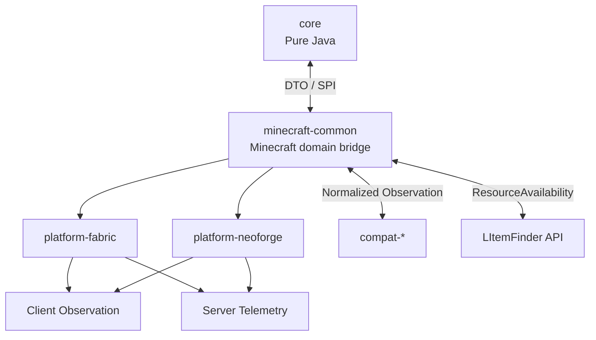
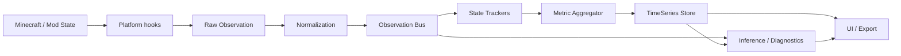
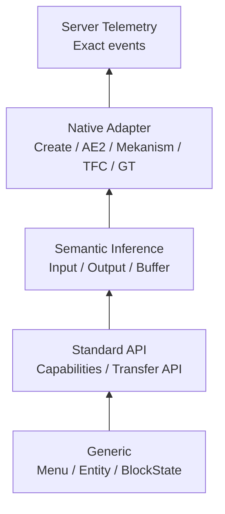
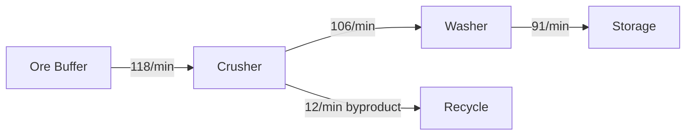
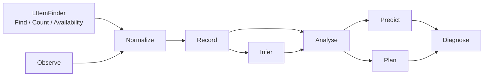

# Minecraft 工业可观测性 / 遥测 Mod 设计研究报告

## 执行摘要

本项目最合适的定位不是“配方计算器”或“产量统计器”，而是一个面向 Minecraft 生电、科技、工业整合包的 **Factory Observability Platform（工厂可观测性平台）**：统一观察物品、流体、能源以及 Mod 自定义资源在生产系统中的存储、流动、加工、等待、损耗和异常，并在此基础上提供生产规划、运行监控、瓶颈定位、容量预测和自动结构识别。

建议将其作为**独立 Mod**，与 LItemFinder 建立稳定 API 联动。LItemFinder 负责“资源发现、位置索引、数量统计和可用性标记”；本 Mod 负责“资源如何流动、为什么不足、什么时候耗尽或溢出、生产系统是否正常”。这与 AE2 本身“网络存储是一等概念”、Create 的物品/流体物流，以及 GregTech 对机器输入、输出、能源、停机原因的区分是一致的。AE2 的 API 甚至已经提供网络级存储服务、缓存库存和存储监视能力，很适合成为 `ResourceNetwork` Adapter 的重要参考。citeturn797606search2turn797606search4turn797606search6

最关键的架构决定是：**服务器支持必须是精确度升级，而不是运行前提。** Client-only 模式只使用服务器本来就发送给客户端的数据，包括已跟踪 Chunk、实体、BlockState、菜单槽位和 Mod 自身同步状态；服务器安装后才提供真实 insert/extract、机器完成事件和离屏持续统计。Minecraft 菜单本身负责服务器—客户端槽位及数据同步，因此 Container/Menu 是极有价值的最低公共兼容层。NeoForge 文档明确指出菜单会同步 `Slot` 的 `ItemStack` 和 `DataSlot` 数据；Fabric 文档同样将 Menu 定义为负责服务器/客户端同步的一侧。citeturn588828search1turn588828search3

同时必须承认 Client-only 的信息边界。Fabric 当前 Transfer API 文档明确说明，客户端可以查询 `Storage<ItemVariant>`，但客户端查询到的内容“不可靠且不应修改”；因此 client-only 层应该以“观察”而不是“权威内省”为语义。NeoForge 的 `IItemHandler`、`IFluidHandler`、`IEnergyStorage` capabilities 很适合服务器或集成服务器上的标准化访问，但不能成为远程纯客户端模式的假设。citeturn271846search2turn965152search0

核心模型应从第一天采用 `Resource`，而不是 `Item`。Mekanism 同时拥有物品、流体、化学品、热和能量传输；Create 的 Basin 同时持有物品和流体，Fluid Pipe 独立构成流体物流；GregTech 机器会同时消耗 EU、处理物品和流体。这说明一个长期可维护的工业监控系统必须把资源类别抽象化。citeturn418299search1turn418299search5turn965152search4turn965152search5turn418299search7

兼容策略应采用五级降级模型：

| 层级 | 目标 | 失败后的降级 |
|---|---|---|
| Generic Observation | Minecraft 原生可见状态、Menu、Entity | 永远尽量可用 |
| Standard API | NeoForge capabilities / Fabric Transfer | Generic |
| Semantic Inference | 自动识别 Input/Output/Buffer/Producer/Transport | Standard/Generic |
| Native Adapter | Create、AE2、Mekanism、TFC、GregTech 深度语义 | Semantic |
| Server Telemetry | 精确事件、离屏监控、完整生命周期 | Native/Local |

这一结构特别重要，因为现有项目已经证明“节点生产规划”本身并不新：GregTech Calculator Board 已拥有节点式产线、稳态循环平衡、多 Mod 能源模型和自动比例缩放；JEI Crafting Tree 已处理递归生产、多目标物料账本、副产物和 item/fluid/chemical/custom ingredient。新的差异化价值应集中在**实际运行态的 observability + inference + theoretical-vs-actual**。citeturn418299search9turn188339search0

## 产品边界、用户与总体架构

### 核心目标与用户

目标用户可以分为三类：大型生电玩家需要农场产率、掉落物和物流瓶颈；科技整合包玩家需要跨物品、流体、能源和化学品的产线监控；整合包作者和服务器维护者需要诊断某条复杂产线为什么没有达到设计吞吐。Minestats 已验证“定期扫描容器并计算生产/消费速率”本身具有用户需求，而 client-side ChestTracker 也证明在服务器无支持时，依赖玩家观察或打开容器记录快照仍然有实际价值。citeturn188339search4turn188339search6

本项目的目标则应比两者更广：不是“监控一个箱子”，而是形成 `Factory → Stage → Node → Edge` 的工业系统模型，并将不同数据源统一到同一 Metric API。

LItemFinder 和本 Mod 的责任建议严格划分如下：

| 能力 | LItemFinder | Industrial Observability Mod |
|---|---:|---:|
| 找到某资源的位置 | ✓ | 通过 API 使用 |
| 汇总已观察库存 | ✓ | 使用 |
| 用户标记 Available / Reserved / Waste | ✓ | 使用 |
| 工厂/Stage 定义 |  | ✓ |
| 流量、WIP、利用率 |  | ✓ |
| 生产/消耗时间序列 |  | ✓ |
| 流体/能源网络 |  | ✓ |
| 生长/农场模型 |  | ✓ |
| 瓶颈/溢出预测 |  | ✓ |
| 理论规划和物料平衡 |  | ✓ |
| 自动结构推断 | 可提供索引信号 | ✓ |
| “定位这个节点的库存” | 被调用 | ✓ |

LItemFinder API 不应返回一个简单的“总库存”，而应该暴露 `ResourceAvailability`，至少区分 **Observed / Reachable / Allocated / Available**。AE2 的存储优先级说明“物理存在于网络”并不等于“所有位置和用途等价”；工业监控中的资源可用性同样需要 scope 和分配语义。citeturn797606search6

### 推荐模块边界



Architectury 官方模板当前仍然采用 `common + fabric + neoforge` 的多子项目结构，这证明“公共逻辑 + loader 薄层”是成熟路径；但这里不建议让 Architectury 类型侵入纯 Java Core。Core 应能够在没有 Minecraft、Fabric、NeoForge、Architectury 的 JUnit 进程里完成物料平衡、时间序列、统计推断和瓶颈求解。citeturn965152search1

推荐仓库：

```text
industrial-observability/
├─ core/
├─ minecraft-common/
├─ platform-fabric/
├─ platform-neoforge/
├─ compat-api/
├─ compat-create/
├─ compat-ae2/
├─ compat-mekanism/
├─ compat-tfc/
├─ compat-gtceu/
├─ integration-litemfinder/
└─ test-fixtures/
```

`core` 只允许 JDK + 数学/序列化库；`minecraft-common` 做 ItemStack/BlockPos/ResourceLocation 到 Core DTO 的映射；`platform-*` 处理 loader event、networking、config、路径和生命周期；`compat-*` 仅负责将具体 Mod 世界状态转成标准 Observation。这个分割也能缓和版本矩阵，因为 Minecraft/loader API 变化不必传播到数学引擎。

## 核心数据模型与 API

下表给出建议的**精确领域模型**。类型名是设计建议，不绑定某个 MC 版本。

| 抽象 | 建议字段 |
|---|---|
| `ResourceId` | `String namespace`, `String path`, `ResourceKind kind`, `Map<String,String> qualifiers` |
| `ResourceStack` | `ResourceId resource`, `double amount`, `Unit unit`, `Map<String,Object> components` |
| `ResourceNetwork` | `UUID id`, `ResourceKind kind`, `Set<NodeId> members`, `Set<EdgeId> edges`, `NetworkScope scope` |
| `Factory` | `UUID id`, `String name`, `WorldIdentity world`, `Set<StageId> stages`, `FactoryScope scope`, `Map<String,String> tags` |
| `Stage` | `UUID id`, `FactoryId factory`, `String name`, `Set<NodeId> nodes`, `Set<StageId> children`, `AggregationPolicy policy` |
| `Node` | `NodeId id`, `NodeKind kind`, `WorldRef worldRef`, `Set<ResourcePort> ports`, `Set<Capability> capabilities`, `Map<String,String> labels` |
| `Edge` | `EdgeId id`, `NodePortRef from`, `NodePortRef to`, `ResourceSelector resource`, `EdgeKind kind`, `OptionalDouble nominalCapacity` |
| `ProducerModel` | `ProducerKind kind`, `Set<ResourceRequirement> inputs`, `Set<ResourceYield> outputs`, `DurationModel duration`, `ProbabilityModel probability` |
| `GrowthModel` | `GrowthStateSchema schema`, `StateTransitionModel transitions`, `YieldModel yield`, `EnvironmentModel environment` |
| `MetricKey` | `String namespace`, `String name`, `MetricDimension dimension`, `Unit unit` |
| `MetricSample` | `MetricKey key`, `Instant time`, `double value`, `MetricProvenance provenance`, `DataQuality quality`, `double coverage`, `double confidence` |
| `Observation` | `ObservationId id`, `Instant time`, `ObservationType type`, `SubjectRef subject`, `ObservationPayload payload`, `Provenance provenance` |
| `TimeSeries` | `MetricKey key`, `SubjectRef subject`, `Resolution resolution`, `List<AggregateBucket> buckets` |
| `Alert` | `UUID id`, `Severity severity`, `AlertType type`, `SubjectRef subject`, `Instant openedAt`, `AlertState state`, `Evidence evidence` |
| `ResourceAvailability` | `ResourceId resource`, `double observed`, `double reachable`, `double allocated`, `double available`, `Coverage coverage`, `List<ResourceSource> sources` |

`ResourceKind` 至少预留：

```java
public enum ResourceKind {
    ITEM,
    FLUID,
    ENERGY,
    CHEMICAL,
    HEAT,
    CUSTOM
}
```

这是有现实依据的：Mekanism 明确将 item、fluid、gas/chemical、heat、energy 都作为不同传输体系；其 reaction 配方可以同时包含 item、fluid、chemical 和 energy requirement。citeturn418299search1turn418299search5

### Metric、Provenance、Quality 和 Coverage

建议严格区分以下四个维度：

```java
public enum Provenance {
    SERVER_EVENT,
    SERVER_SNAPSHOT,
    CLIENT_SYNC,
    CLIENT_OBSERVATION,
    NATIVE_ADAPTER,
    SEMANTIC_INFERENCE,
    USER_DECLARED
}

public enum DataQuality {
    EXACT,
    OBSERVED,
    ESTIMATED,
    INFERRED,
    UNKNOWN
}
```

`coverage ∈ [0,1]` 表示**目标时间/空间范围中实际有观测数据的比例**；`confidence ∈ [0,1]` 表示**在已有证据下，某个估计/推断成立的可信程度**。两者绝不能合并。

例如玩家在 1 小时统计窗口中只在工厂附近停留 12 分钟：

\[
coverage=\frac{12}{60}=0.2
\]

即使这 12 分钟中的 `Menu slot count` 是精确同步的，`quality` 可以是 `OBSERVED`，但 coverage 仍只有 0.2。Minecraft 本身采用 tracking 概念，只向需要知道某实体或 Chunk 的客户端同步相应状态，因此 client-only 监控天然受到观察范围约束。citeturn588828search0

推荐 API：

```java
public interface MetricStore {
    void append(MetricSample sample);

    Optional<MetricAggregate> query(
        SubjectRef subject,
        MetricKey metric,
        TimeRange range,
        Aggregation aggregation
    );

    Stream<MetricSample> stream(
        SubjectRef subject,
        MetricKey metric,
        TimeRange range
    );
}

public interface ObservationSink {
    void emit(Observation observation);
}

public interface ObservationProvider {
    ProviderId id();
    Set<ObservationCapability> capabilities();
    void start(ObservationContext context, ObservationSink sink);
    void stop();
}

public interface ResourceAvailabilityProvider {
    ResourceAvailability query(
        ResourceSelector resource,
        AvailabilityScope scope
    );
}
```

LItemFinder 最适合实现最后一个接口，Industrial Mod 只消费它，不直接侵入 LItemFinder 的内部索引结构。

### Adapter SPI

推荐：

```java
public interface IntegrationAdapter {
    AdapterId id();
    String targetModId();
    Set<AdapterCapability> capabilities();

    boolean isApplicable(RuntimeContext context);

    void register(AdapterRegistrar registrar);
}

public interface MachineAdapter<T> {
    boolean supports(T target);

    MachineDescriptor describe(T target, AdapterContext ctx);

    void observe(
        T target,
        ObservationSink sink,
        AdapterContext ctx
    );
}

public interface GrowthAdapter<T> {
    boolean supports(T target);

    GrowthState observeState(T target, AdapterContext ctx);

    Optional<GrowthEstimate> estimate(
        T target,
        GrowthHistory history,
        AdapterContext ctx
    );
}
```

能力枚举建议：

```java
public enum AdapterCapability {
    ITEM_STORAGE,
    ITEM_FLOW,
    FLUID_STORAGE,
    FLUID_FLOW,
    ENERGY_STORAGE,
    ENERGY_FLOW,
    CHEMICAL_STORAGE,
    CHEMICAL_FLOW,

    MACHINE_STATE,
    RECIPE_PROGRESS,
    PROCESS_COMPLETION,

    INPUT_OUTPUT_CLASSIFICATION,
    TRANSPORT_POSITION,
    TRANSPORT_SPEED,

    GROWTH_STATE,
    GROWTH_ENVIRONMENT,
    EXACT_YIELD_MODEL,

    NETWORK_TOPOLOGY,
    OFFSCREEN_TELEMETRY
}
```

能力声明必须细粒度，因为 Create、AE2、Mekanism、GregTech 的模型并不相同。AE2 是 grid/network-centric；Create 很多物流具有实体式空间位置；GregTech 有明确 recipe progress、能源和 powerstall；Mekanism 则拥有多资源 transmitter。citeturn797606search2turn965152search3turn418299search7turn418299search1

## 观测管线、兼容策略与推断

### Event-driven + Periodic Sampling

推荐数据流：



原则是**事件驱动优先，低频采样补齐**。不应每 tick 扫描全部机器、库存和实体。NeoForge 官方专门提醒高频 capability lookup 可能产生明显服务器开销，并提供 `BlockCapabilityCache` 来避免频繁查询成本；Fabric `Storage` 则提供 `getVersion()` 用于快速检测内容是否变化，从而避免无变化时重新扫描。citeturn965152search0turn271846search3

建议三个层级：

| 数据 | 策略 |
|---|---|
| Insert/extract、recipe completion、entity spawn | 事件计数 |
| Inventory/tank/energy level | 变化检测 + 低频采样 |
| 长期历史 | 时间桶聚合和降采样 |

参考参数可从 `1 s` 原始统计桶开始，随后将旧数据降采样成 10 s、1 min、5 min；这不是协议要求，而是推荐默认值，必须可配置。

### Generic / Standard / Semantic / Native 的兼容金字塔



Generic 层的重要性最高，因为它让“未知 Mod”也有最低可用性。NeoForge 菜单的 Slot/DataSlot 和 Fabric Menu 的同步机制意味着玩家打开未知机器时，至少可以观察客户端菜单的库存状态变化。citeturn588828search1turn588828search3

Standard 层使用 NeoForge `IItemHandler/IFluidHandler/IEnergyStorage` 和 Fabric `Storage<ItemVariant>/Storage<FluidVariant>`。NeoForge 官方明确将这三个 capability 作为通用跨 Mod 互操作接口；Fabric Transfer API 同样以 `Storage<T>` 统一 item 和 fluid 传输。citeturn965152search0turn271846search0turn271846search3

Native 层则针对语义差异：Create Mechanical Belt 可搬运物品并允许 Funnel/Tunnel 加入、取出和分流；Fluid Pipe + Mechanical Pump 构成独立流体网络；Basin 同时有 item/fluid I/O。citeturn965152search3turn965152search4turn965152search5

AE2 更适合映射为 `ResourceNetwork`：`IStorageService` 提供 grid-wide inventory 和 cached inventory，`MEStorage` 是其网络存储抽象。citeturn797606search1turn797606search4

GregTech Adapter 应重点暴露 machine state、EU demand、recipe progress、item/fluid I/O 和 powerstall。官方文档明确指出机器运行配方时每 tick 消耗 EU，缺电会 powerstall 并重置进度；电机还有 item/fluid auto-output，而 multiblock 用 bus/hatch 处理 I/O。citeturn418299search7turn418299search8

### Discovery / Inference Engine

未知系统不应返回“Unsupported”，而应形成 hypothesis：

```java
public record Hypothesis(
    HypothesisType type,
    SubjectRef subject,
    double confidence,
    List<Evidence> evidence,
    Instant createdAt
) {}
```

推断输入包括：

\[
E =
\{
状态转移,\ 时间相关,\ 空间相关,\ 资源变化,\ 重复周期
\}
\]

例如观察：

```text
Block state A → B → C → A
同时在 C→A 后 0.2s 内出现 Wheat
连续 34 次
```

可以生成：

```text
Hypothesis:
CYCLIC_STATEFUL_PRODUCER

confidence = 0.91
```

UI 必须显示“为什么判断”，而不是只给结论。用户确认或纠正后，生成 `USER_DECLARED` rule，并允许作用于 object/block type/factory/world。这个“observe → infer → ask → learn”循环是实现大量未知 Mod 兼容的关键设计，而不是试图维护数百个硬编码 Mod 分支。

推荐的 Adapter 能力级别：

| 适配状态 | 库存 | 流量 | 机器状态 | 网络拓扑 | 生长模型 | 精确度 |
|---|---:|---:|---:|---:|---:|---|
| Generic | 部分 | 净变化估计 | 很少 | 推断 | 输出统计 | 低–中 |
| Standard API | ✓ | 部分 | 少量 | 部分 | 无 | 中 |
| Semantic | ✓ | 推断 | 推断 | 推断 | 经验 | 中 |
| Native | ✓ | ✓ | ✓ | ✓ | 视 Mod | 高 |
| Server Telemetry | ✓ | 精确 | 精确 | ✓ | 精确/经验 | 最高 |

## 工业计算：机器、农场、流体、能源与诊断

### Producer 与 Growth 模型

生产系统至少分为：

```java
public enum ProducerKind {
    DETERMINISTIC,
    STATEFUL,
    PERIODIC,
    EVENT_DRIVEN,
    EMPIRICAL
}
```

普通工业机器通常接近 deterministic producer，而农场是 stateful producer。TFC 是一个很好的反例，说明不能假设“Minecraft CropAge + randomTick”就是通用生长模型：其生长受季节、当前温度、降雨/水分等气候因素影响，不同作物还有不同温度和 hydration 区间。citeturn797606search8turn797606search9

因此 `GrowthModel` 推荐：

```java
public interface GrowthModel {
    GrowthState observe(ProducerRef producer, ObservationContext ctx);

    Optional<GrowthEstimate> estimate(
        GrowthState current,
        GrowthHistory history,
        EnvironmentSnapshot environment
    );
}

public record GrowthEstimate(
    Optional<DurationDistribution> timeToNextStage,
    Optional<DurationDistribution> timeToMaturity,
    YieldDistribution expectedYield,
    double confidence,
    Provenance provenance
) {}
```

对未知 Mod，使用 empirical model：根据已观测完整周期估计周期分布和 yield 分布。这样即使 Mod 覆写 vanilla 生长、使用 BlockEntity、控制器或季节系统，只要最终客户端能观察状态或收获输出，就仍可工作。

农场应拆为：

```text
Growth → Harvest → Collection → Processing → Storage
```

这样可以区分“作物生长慢”与“收割/拾取物流不够”。这一点是工业诊断而不是传统农场计时器的核心。

### 多资源机器、流体和能源

统一端口模型：

```java
public record ResourcePort(
    PortId id,
    PortDirection direction,
    ResourceSelector accepted,
    OptionalDouble nominalRate,
    PortRole role
) {}

public enum PortRole {
    INPUT,
    OUTPUT,
    BUFFER,
    CATALYST,
    WASTE,
    POWER,
    UNKNOWN
}
```

Mekanism 的 reaction recipe 可以同时有 item、fluid、chemical input、额外 energy required，同时输出 item + chemical；这直接证明 `MachineNode` 不应以单物料配方为模型。citeturn418299search5

### WIP、Flow 与 Lead Time

对任意 Stage：

\[
WIP(t)=\sum_{r\in IntermediateResources} Q_r(t)
\]

但建议同时支持“原始数量”和“归一化成目标产品等价量”，因为 1000 mB 流体、64 个 item 和 1 MJ 能源不能直接相加。

Lead Time 的统计可以通过可追踪 token、实体 trajectory，或相关性估计实现：

\[
LeadTime =
T_{output}-T_{input}
\]

显示：

```text
P50 = 31.2 s
P95 = 58.7 s
P99 = 104.4 s
```

对于 ItemEntity 应同样优先 P50/P95/P99，而不是仅平均数。client-only 模式必须把 `CHUNK_UNLOADED / LOST_VISIBILITY / SESSION_ENDED` 作为 censored observation，不能错误地当成实体已被拾取或销毁；这直接来自客户端 tracking 范围的客观限制。citeturn588828search0

### 溢出、耗尽与维护 ETA

对于缓冲区：

\[
r=\lambda_{in}-\lambda_{out}
\]

若 \(r>0\)：

\[
T_{overflow}
=
\frac{C-Q}{r}
\]

若 \(r<0\)：

\[
T_{empty}
=
\frac{Q}{-r}
\]

但真实流量具有波动，因此实际 UI 不应仅显示单点 ETA，而应从近期 rate distribution 给出区间：

```text
预计满仓：24 min
典型区间：19–31 min
Confidence: Medium
```

人工维护周期可对安全阈值 \(C_s=\alpha C\) 使用：

\[
T_{maintenance}
=
\frac{C_s-Q}{r}
\]

从而区别“建议清空时间”和“硬溢出时间”。

### 瓶颈

理论瓶颈可定义为利用率：

\[
u_i=\frac{d_i}{c_i}
\]

其中 \(d_i\) 为需求、\(c_i\) 为有效能力。运行态还应结合 queue growth：

\[
q'_i=\lambda_i-\mu_i
\]

若某节点 `u≈1` 且上游 queue 持续增长，则可作为高可信 bottleneck；若 `u<1` 但机器常处于 `BLOCKED_OUTPUT`，则真正瓶颈在下游。

GregTech 对“缺电导致 powerstall”和输出物流状态的明确区分说明，machine utilization 必须细分原因，而不是只有 running/idle。citeturn418299search7turn418299search8

### Material Balance Solver

规划层建议使用物料—工序矩阵：

\[
S\in \mathbb{R}^{m\times n}
\]

其中：

\[
S_{ij}
=
\text{工序 }j\text{ 对资源 }i\text{ 的净产出}
\]

稳态：

\[
Sx+b-d=0
\]

其中：

- \(x\)：各工序执行速率；
- \(b\)：外部输入；
- \(d\)：目标输出。

线性规划：

\[
\min c^\top x + p^\top b
\]

约束：

\[
Sx+b-d=0,\quad
0\le x\le c_{machine}
\]

可用于最少原料、最少机器、最少能耗或最大吞吐。概率副产物先使用期望值作为稳态模型，并另外传播方差/置信区间；机器整数数量或离散配方选择可进入 MILP。

这一方向与 GregTech Calculator Board 已实现的稳态 recirculation balancing、auto-ratio sizing 非常一致，而 JEI Crafting Tree 也证明 secondary output/global material ledger 是必须考虑的配方语义。citeturn418299search9turn188339search0

### Anomaly Detection

V1 不需要机器学习。推荐先使用：

- EWMA / rolling median；
- MAD 或 robust z-score；
- rate-of-change；
- 与同时间段 baseline 对比；
- 状态占比突变。

例如：

```text
过去 2h baseline：105–120 item/min
当前 5m：71 item/min

同时：
Input normal
Washer queue +280%
Output belt saturation 99%
```

可输出“可能的下游运输瓶颈”，但必须保留 hypothesis/confidence，而不是断言因果。

## 用户界面、导出与数据展示

### Structured Inspector

Structured View 应是“工程控制台”，不是纯文字 dump。目标是高密度、可排序、可筛选、可复制。

```text
▼ Steel Factory                         LIVE ●
  Output     91.4/min
  WIP        483 eq.
  Yield      84.2%
  Coverage   92%

  ▼ Washing                             ⚠
    Dirty Ore
      In       116.7/min
      Out       91.4/min
      Queue     187
      Net       +25.3/min
      Full in   8m 42s

    Washer ×2
      Running       81.2%
      Output Block  18.0%
```

排序至少应支持：

| 维度 | 用途 |
|---|---|
| Factory/Stage | 结构浏览 |
| Resource | 看某物料全链路 |
| Alert severity | 排障 |
| Throughput | 找主干物流 |
| Utilization | 找高负载机器 |
| WIP growth | 找堆积 |

### Graph Node View

节点图的核心是 **Edge-first**：



Graph 至少有三个 aggregation level：

```text
Process:
Crushing → Washing → Smelting

Logistics:
Crusher → Belt → Buffer → Washer

Physical:
Crusher #17 → Belt #311 → Funnel #42 → Chest #8
```

这应通过 **semantic zoom** 实现，而不是维护三张完全独立的图。

Overlay 建议：

| Overlay | 显示 |
|---|---|
| Throughput | 边宽、rate |
| Capacity | utilization |
| Inventory | buffer fill |
| Latency | P50/P95 |
| WIP | 阶段堆积 |
| Bottleneck | 高亮限制节点 |
| ItemEntity | 掉落物热点 |
| Fluid | 流体网络 |
| Energy | 供需和 buffer |
| Confidence | 推断边/低质量数据 |

Structured 和 Graph 必须共享 `NodeId/EdgeId`，支持互跳。

### Trace

“Trace upstream/downstream” 是大型整合包的核心功能：

```text
Trace upstream Iron Dust
Ore → Crusher → Washer → Iron Dust

Trace downstream Iron Dust
Iron Dust → Steel
          → Plate
          → Gear
```

AE2 网络不能简单展开为每条物理存储路径；它更适合先作为 network super-node，再允许用户展开 network storage/service。AE2 的 grid-wide `IStorageService` 天然支持这种抽象。citeturn797606search4

### 图表与导出

Chart 是两套视图共用组件：

```text
rate(t)
inventory(t)
WIP(t)
entity count(t)
utilization(t)
latency percentile(t)
energy demand/supply(t)
```

导出必须支持：

```text
CSV    — 时间序列和表格
JSON   — 完整机器可读模型
Markdown — 可发送到 issue/Discord 的摘要
```

建议 JSON 带：

```json
{
  "schemaVersion": 3,
  "worldId": "...",
  "factoryId": "...",
  "exportedAt": "...",
  "data": {}
}
```

这也有利于以后提供外部 Grafana/Prometheus exporter，但不需要让它成为首版依赖。

## 性能、持久化、兼容矩阵与路线图

### 性能预算

系统最重要的性能原则是：**监控 Mod 不能成为被监控对象中最重的东西。**

推荐：

| 类型 | 方法 |
|---|---|
| 资源 transfer | event counter |
| capability/storage | cache + version/change detection |
| opened Menu | 直接比较同步 slot snapshot |
| ItemEntity | entity add/remove + 低频位置采样 |
| Growth | state transition |
| 历史 | bucket aggregation |
| 图拓扑 | 事件触发重建，不每 tick 扫描 |

NeoForge 官方建议频繁 capability 查询采用 `BlockCapabilityCache`；Fabric Storage 提供 `getVersion()` 作为快速变化检测，这两点都应直接利用。citeturn965152search0turn271846search3

可以定义运行时预算，例如每 tick 只处理最多 N 个 deferred observation task，把昂贵 topology discovery 分摊到多 tick；历史聚合则在 worker thread 做，但绝不能从异步线程读取未经线程安全保障的 Minecraft world 对象。

### 持久化和版本

推荐本地结构：

```text
<gameDir>/
└─ industrial-observability/
   ├─ config.json
   ├─ worlds/
   │  └─ <world-id>/
   │     ├─ factories.json
   │     ├─ labels.json
   │     ├─ inference-rules.json
   │     └─ metrics.db
   └─ exports/
```

不要识别 PCL、HMCL、Prism、CurseForge、Modrinth App 等启动器；只使用当前实例的标准 game/config 路径。这样“跨启动器”实际上退化为普通文件持久化问题，而真正要处理的是迁移实例时的数据导出/导入。Architectury 的多平台工程结构本身也强调平台抽象而不是 launcher 抽象。citeturn965152search1

`WorldIdentity` 建议：

```java
public record WorldIdentity(
    WorldKind kind,
    String primaryId,
    Optional<String> serverAddressHash,
    String dimensionId,
    Optional<UUID> serverProvidedUuid
) {}
```

多人服务器不建议只使用明文 hostname；可在本地用规范化 endpoint + salt hash，并在服务器支持时优先使用服务端提供的稳定 UUID。

数据库必须带 schema migration：

```text
schema_version
created_with_mod_version
world_identity_version
metric_dictionary_version
```

时间序列推荐 SQLite 或自定义 append-only segment + compacted buckets；如果未来需要百万级 sample，JSON 不应成为主历史格式。

### 与现有项目的差异

| 项目 | 强项 | 本项目应避免重复 |
|---|---|---|
| GregTech Calculator Board | 节点规划、稳态、机器/能源模型 | 不把“规划器”当唯一卖点 |
| JEI Crafting Tree | 递归配方、多目标、库存分配、副产物 | 不重复做纯 recipe tree |
| Minestats | 容器 item/fluid 统计 | 扩展到拓扑、语义和诊断 |
| AE2 | 网络级 storage/service | 用 Adapter 映射为 ResourceNetwork |
| Create | 可视物流、belt/fluid systems | 利用其空间物流语义做 native flow |
| Mekanism | 多资源 transmitter | 验证 Resource 抽象 |
| TFC | 气候/水分生长 | 验证 GrowthModel 不可写死 |

GTCalcBoard 当前已经支持 GregTech、Create、AE2 等多 Mod 规划语义，并拥有节点画布、steady-state recirculation 等能力；JEI Crafting Tree 已支持 item/fluid/chemical/custom ingredient 和 secondary output。因此项目的长期差异化应坚持 Runtime Observability、Inference、Prediction 和 Diagnostics。citeturn418299search9turn188339search0

### 推荐版本路线

| 阶段 | 核心目标 | 范围 |
|---|---|---|
| **V0** | Generic client-only foundation | Core 模型、Factory/Stage、Menu snapshot、ItemEntity、Structured View、基础 Graph、LItemFinder availability |
| **V0.5** | 工业监控可用 | Flow estimate、WIP、overflow/depletion ETA、history、CSV/JSON/Markdown、Discovery prototype |
| **V1** | 多资源与首批深度适配 | Fluid、Energy、Create、AE2、Machine state、Growth empirical model、alerts |
| **V1.5** | Server telemetry | exact transfer、off-screen history、exact entity lifecycle、server/client merge |
| **V2** | 规划与诊断闭环 | Material-balance solver、LP/MILP、theoretical-vs-actual、what-if simulation、advanced bottleneck |
| **V2+** | 生态化 | Mekanism/TFC/GTCEu native adapters、third-party SPI、external telemetry exporter |

MVP 的成功指标不应是“支持多少 Mod”，而应该是：

> **一个完全未知的工业 Mod，在没有 Native Adapter 的情况下，能正确恢复多少库存、生产、流动和周期信息？**

如果 Generic + Semantic 层足够强，Native Adapter 就是增强精度和语义，而不是“能用/不能用”的开关。这是整个项目长期可维护性的决定性标准。

### 关键官方资料链接

以下资料应作为实现阶段的首选参考，并根据最终选择的 Minecraft/Loader 版本固定 API revision；当前文档已经出现 1.21.x 与 26.x 两套版本线，因此代码不能假设跨 MC 大版本 API 名称稳定。Fabric 26.1 的迁移文档就列出了多项 Transfer API 类型改名，说明版本隔离层是必要的。citeturn271846search4

- Architectury Docs: https://docs.architectury.dev/
- NeoForge Capabilities: https://docs.neoforged.net/docs/1.21.1/inventories/capabilities/
- NeoForge Menus: https://docs.neoforged.net/docs/1.21.1/gui/menus/
- Fabric Documentation: https://docs.fabricmc.net/
- Fabric Transfer API Javadocs: https://maven.fabricmc.net/docs/
- Create GitHub/Wiki: https://github.com/Creators-of-Create/Create
- AE2 Guide: https://guide.appliedenergistics.org/
- AE2 API Javadocs: https://appliedenergistics.org/javadoc/
- Mekanism GitHub: https://github.com/mekanism/Mekanism
- Mekanism Wiki: https://wiki.aidancbrady.com/
- TerraFirmaCraft Documentation: https://terrafirmacraft.github.io/Documentation/
- TFC Field Guide: https://terrafirmacraft.github.io/Field-Guide/
- GregTech CEu Modern Docs: https://gregtechceu.github.io/GregTech-Modern/
- GregTech Calculator Board: https://github.com/Amvermain/GregTechCalculatorBoard
- JEI Crafting Tree: https://modrinth.com/mod/jei-crafting-tree
- Minestats: https://modrinth.com/mod/minestats-mod

最终架构可以浓缩成：



LItemFinder 回答的是：

**“资源在哪里、有多少、哪些被标记为可以使用？”**

Industrial Observability Mod 回答的是：

**“这些资源怎样进入生产系统、实际以多快的速度流动、哪里堆积、哪里受限、什么时候需要维护，以及当前系统为什么没有达到计划产能？”**

从研究到的现有 API 和项目来看，这一职责划分既符合 Minecraft 当前的客户端/服务器数据边界，也避开了现有配方规划工具已经高度覆盖的领域，同时为 Create、AE2、Mekanism、GregTech、TFC 等结构差异极大的工业生态提供了可持续的兼容路径。citeturn588828search0turn965152search0turn797606search4turn418299search5turn418299search7turn797606search8